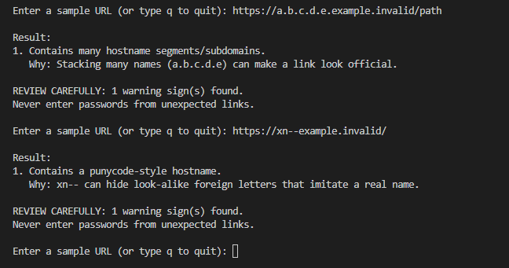
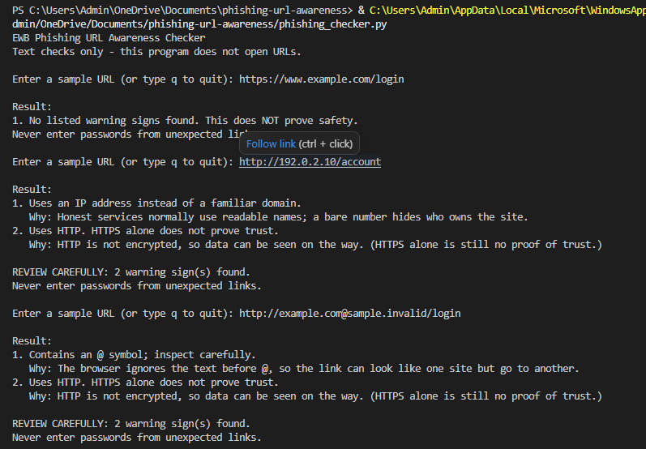

# EWB Phishing URL Awareness Checker

## Overview
Phishing is a trick where a criminal sends a fake link or message to make you share a password, card number or OTP. This small Python command-line tool reads a URL as plain text and points out a few visible warning signs. It never opens the link, so it is safe to practise with.

## Features
- Detects an @ symbol in the URL
- Flags unusually long URLs (over 100 characters)
- Flags IP-address hostnames
- Flags many hostname segments (5 or more)
- Flags punycode-style hostnames (xn--)
- Flags the HTTP scheme
- Loop mode: check many URLs in one run, type `q` to quit
- "REVIEW CAREFULLY" summary with the number of warnings
- Safe handling of malformed input (no crash)
- A simple "Why:" explanation under every warning

## Requirements
Python 3.10 or later. No extra packages.

## How to Run
Windows: `python phishing_checker.py`

Mac/Linux: `python3 phishing_checker.py`

## Example Output
```
EWB Phishing URL Awareness Checker
Text checks only - this program does not open URLs.

Enter a sample URL (or type q to quit): http://192.0.2.10/account

Result:
1. Uses an IP address instead of a familiar domain.
   Why: Honest services normally use readable names; a bare number hides who owns the site.
2. Uses HTTP. HTTPS alone does not prove trust.
   Why: HTTP is not encrypted, so data can be seen on the way. (HTTPS alone is still no proof of trust.)

REVIEW CAREFULLY: 2 warning sign(s) found.
Never enter passwords from unexpected links.
```

## Testing
| # | Input | Expected | Actual | Result |
|---|-------|----------|--------|--------|
| 1 | https://www.example.com/login | No warning signs | No listed warning signs found | PASS |
| 2 | http://192.0.2.10/account | IP address + HTTP | IP address + HTTP flagged | PASS |
| 3 | http://example.com@sample.invalid/login | @ symbol + HTTP | @ symbol + HTTP flagged | PASS |
| 4 | https://a.b.c.d.e.example.invalid/path | Many hostname segments | Many hostname segments flagged | PASS |
| 5 | https://xn--example.invalid/ | Punycode-style hostname | Punycode-style hostname flagged | PASS |

Full table with exact output is in `tests/test_samples.md`.

## Screenshots



## Improvements
1. **Loop with quit** - the program now keeps asking for URLs until the user types `q`, `quit` or `exit`. I added it so many URLs can be checked without restarting. I tested it by entering several URLs and then `q`.
2. **Review carefully summary** - a helper function `has_warnings()` separates real warnings from information messages, and the program prints how many warning signs were found. I tested it with all five samples and with empty input (no summary should appear for it).
3. **Malformed input handling** - `urlparse` is wrapped in `try/except ValueError`, so input like `http://[bad` shows a friendly message instead of crashing. I tested it with `http://[bad`.
4. **Warning explanations** - a `REASONS` dictionary maps each warning to a one-line reason in simple words, printed under the warning. I re-ran all five tests to make sure nothing broke.

## Limitations
This is an educational tool. It only reads URL text. It does not visit URLs, scan for malware or prove that a URL is safe. No warning signs found does NOT mean a URL is safe.

## Ethical Use
Use sample strings only. Do not collect credentials. Do not use this project to deceive anyone or to test websites without permission.

## Author
Mohd Ruman Khan, EWB Courses
